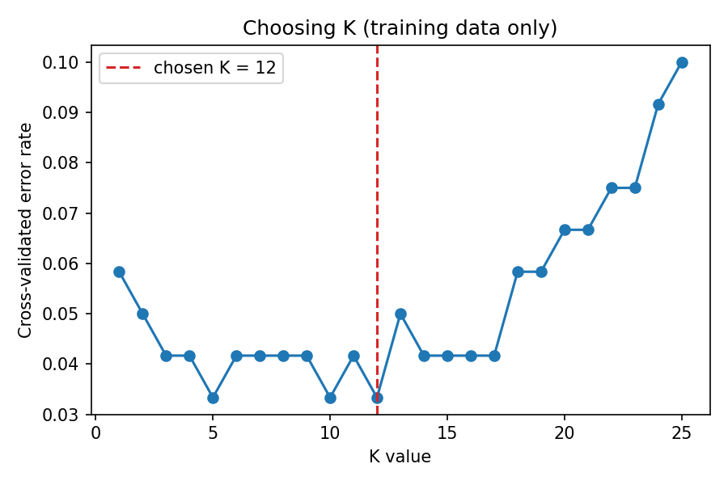
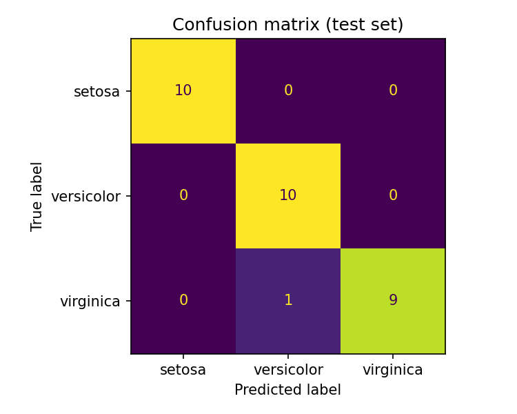

# 🌸 Data Classification Using AI: Iris + K-Nearest Neighbors

**DecodeLabs · Artificial Intelligence · Project 2 (Batch 2026)**

A supervised-learning pipeline that classifies iris flowers into three species
(*setosa*, *versicolor*, *virginica*) from four measurements. Instead of
hand-writing rules (Project 1), we give the machine labelled history and let
it derive the logic.

## Pipeline (IPO)

| Phase   | Steps                                                              |
|---------|--------------------------------------------------------------------|
| Input   | Load Iris (150 samples, 4 features, 3 balanced classes) → shuffled, stratified 80/20 split |
| Process | `StandardScaler` → choose K by 5-fold cross-validation → train `KNeighborsClassifier` |
| Output  | Accuracy, confusion matrix, per-class precision / recall / F1      |

## Design decisions

- **Scaling lives inside a `Pipeline`**, so the scaler is fitted on training
  data only. Fitting it on the full dataset would leak test information.
- **K is chosen on training data only** (5-fold cross-validation over K = 1…25),
  never by peeking at the test set. Ties go to the larger, smoother K.
- **Stratified split** keeps the 10/10/10 class balance in the test set.
- **Fixed `random_state=42`** makes results reproducible.
- **Accuracy is not enough**: the confusion matrix and F1 show *which*
  classes get confused, which matters most on imbalanced data.

## Results (default run)

K = 12 selected by cross-validation. Test accuracy on 30 held-out samples: **96.7%**

```
              precision    recall  f1-score   support

      setosa      1.000     1.000     1.000        10
  versicolor      0.909     1.000     0.952        10
   virginica      1.000     0.900     0.947        10

    accuracy                          0.967        30
```

One *virginica* flower was predicted as *versicolor*, the two species that
overlap most in feature space. With only 30 test samples, one mistake moves
accuracy by ~3 points, so treat small differences between runs with caution.

| K selection | Confusion matrix |
|:-:|:-:|
|  |  |

## Getting started

Requires Python 3.9+.

```bash
git clone https://github.com/<your-username>/iris-knn-classifier.git
cd iris-knn-classifier
python -m venv .venv && source .venv/bin/activate   # Windows: .venv\Scripts\activate
pip install -r requirements.txt
python classifier.py            # auto-select K
python classifier.py -k 5       # or set K manually
```

Plots are written to `docs/` (change with `--out-dir`).

## Tests

```bash
python -m unittest discover -s tests -v
```

Covers dataset shape, split sizes and class balance, reproducibility, no
scaler leakage, K-selection logic, and an end-to-end run.

## Ideas to extend

- Compare other algorithms (Logistic Regression, Decision Tree, SVM)
- Try different distance metrics or `weights="distance"`
- Test with completely new measurements or a different dataset
- Next step in the track: Deep Learning & CNNs (computer vision)

## Structure

```
iris-knn-classifier/
├── classifier.py
├── tests/test_classifier.py
├── docs/                 # generated plots
├── requirements.txt
├── README.md
├── LICENSE
└── .gitignore
```

## License

MIT, see [LICENSE](LICENSE).
